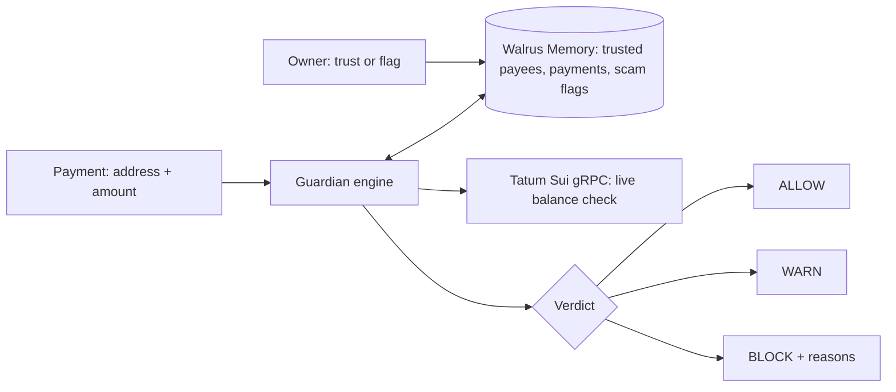

# Wallet Guardian

> A Sui payment guardian that **learns how you pay**, remembers it on **Walrus Memory**, and checks every destination live through **Tatum**, so lookalike-address scams get blocked before you sign.

Built for the **Tatum × Walrus Total Recall** hackathon · Track: _Smart Agents for Real Life_

## The problem

Address-poisoning scams send a tiny "dust" transaction from an address that matches the **start and end** of one you really use. Later you copy it from your history and send funds to the attacker. A stateless tool can only say "this address is new", which is true for every legitimate new payee too. To catch the trick, the guardian has to **remember who you actually pay**.

## What it does

| Step        | What happens                                                                        | Powered by                      |
| ----------- | ----------------------------------------------------------------------------------- | ------------------------------- |
| 1. Remember | Stores trusted counterparties, past payments, and your confirm/reject decisions     | **Walrus Memory** (Sui mainnet) |
| 2. Check    | Reads the destination's live SUI balance on Sui mainnet                             | **Tatum** Sui gRPC gateway      |
| 3. Decide   | Scores the payment and returns **ALLOW / WARN / BLOCK** with plain-language reasons | Guardian engine                 |
| 4. Learn    | Your answer is written back to memory, so a rejected address is blocked next time   | **Walrus Memory**               |



## Why memory matters (before / after)

Same payments, same live chain check. Only difference: whether the guardian can recall your history.

| Scenario                            | Memory off                          | Memory on                                                           |
| ----------------------------------- | ----------------------------------- | ------------------------------------------------------------------- |
| Poisoned lookalike of your landlord | WARN or ALLOW, no reason it matters | **BLOCK**: "Looks like _Ada (landlord)_ but is a different address" |
| Normal rent to the real address     | ALLOW or WARN                       | **ALLOW**                                                           |
| Huge payment to a brand-new address | WARN                                | **BLOCK** (unusual amount, new payee)                               |
| Same address after you flagged it   | WARN                                | **BLOCK**: "flagged earlier"                                        |

Scripted demo result: memory on gets **4 of 4** expected decisions. Memory off gets **2 of 4** with a simulated chain and **1 of 4** with the live chain.

> **Read this honestly:** the demo addresses are synthetic and empty on mainnet, so the live Tatum check flags them. This shows the mechanism. It is **not** a measurement of accuracy on real users.

## How the risk score works

| Signal                                                                         | Points | Source           |
| ------------------------------------------------------------------------------ | ------ | ---------------- |
| Address was flagged as a scam before                                           | +100   | Walrus Memory    |
| Lookalike of a trusted address (same first 6 and last 4 hex, different middle) | +80    | Walrus Memory    |
| First time paying this address                                                 | +30    | Walrus Memory    |
| Amount more than 5x your usual                                                 | +30    | Walrus Memory    |
| Destination holds under 0.001 SUI                                              | +25    | **Tatum** (live) |

**BLOCK** at 70 or more · **WARN** at 40 or more · otherwise **ALLOW**.

## Evidence (verifiable)

| Claim                                                                               | Where to check                                                                             |
| ----------------------------------------------------------------------------------- | ------------------------------------------------------------------------------------------ |
| Memory writes reached Walrus mainnet and were recalled                              | [`results/walrus-ledger.json`](results/walrus-ledger.json): each entry has a blob ID       |
| A write is counted only after the job finished **and** a recall returned the record | `WalrusMemory.remember()` in [`src/memory.js`](src/memory.js)                              |
| The latest demo ran on live Tatum                                                   | [`results/demo-evidence.json`](results/demo-evidence.json) shows `"simulatedChain": false` |
| Memory persists beyond local files                                                  | The guardian recalls from Walrus on every check; the ledger is only a local receipt        |

## How it uses the sponsors

**Walrus Memory:** `@mysten-incubation/memwal` SDK with `remember`, `waitForRememberJob` and `recall`. Each record is stored as text tagged `[guardian:<kind>]` with kinds `trusted_counterparty`, `payment` and `scam_flag`. Recall is semantic, so results are filtered by kind after retrieval.

**Tatum:** Sui **gRPC** gateway (`sui-mainnet-grpc.gateway.tatum.io`) using `GetBalance` and `GetServiceInfo`, authenticated with the `x-api-key` header. Note: the older JSON-RPC route returned 404 for our key on mainnet and testnet, so the project uses gRPC.

## Quick start

**Offline demo** (local memory, simulated chain; no accounts needed):

```bash
npm install
node src/demo.js
npm test
```

**Live mode** (Walrus mainnet + Tatum mainnet):

1. `cp .env.example .env` (Windows: `copy .env.example .env`) and set `MEMORY_BACKEND=walrus`, `MEMWAL_KEY`, `MEMWAL_ACCOUNT_ID`, `TATUM_API_KEY`.
2. The `proto/` folder (from [MystenLabs/sui-apis](https://github.com/MystenLabs/sui-apis)) must be in the project root. It is included in this repo.
3. Run:

```bash
npm install
npm run smoke       # write -> wait -> recall on Walrus
npm run demo:live   # PowerShell: $env:USE_TATUM='1' first, to use live Tatum
node --env-file=.env src/cli.js check <address> <amountSui>
```

**Local demo page:**

```bash
node --env-file=.env src/server.js
```

Open http://localhost:3000. Check a payment with memory on or off, then teach the guardian (trust or flag an address). The page binds to `127.0.0.1` and refuses other hosts and origins. It runs locally with your own keys by design (bring-your-own-key). A hosted version would add sign-in and a separate Walrus delegate key for each user, so no shared key is ever exposed.

## Project structure

| Path                                  | Purpose                                                                          |
| ------------------------------------- | -------------------------------------------------------------------------------- |
| `src/guardian.js`                     | Risk engine: lookalike detection, scoring, feedback                              |
| `src/memory.js`                       | Memory backends: Walrus (with verified-write ledger), local, and none (baseline) |
| `src/tatum-grpc.js`                   | Tatum Sui gRPC client (live balance check)                                       |
| `src/server.js` + `public/index.html` | Local demo page                                                                  |
| `src/cli.js`                          | Command-line checks                                                              |
| `src/demo.js`                         | Scripted memory off vs on comparison                                             |
| `scripts/`                            | Smoke tests for Walrus and Tatum                                                 |
| `test/`                               | Unit tests (5 passing)                                                           |

## Status

| Area                                                | Implemented | Tested       | Live-verified                         |
| --------------------------------------------------- | ----------- | ------------ | ------------------------------------- |
| Risk engine (lookalike, new payee, amount, flagged) | yes         | yes          | yes (demo)                            |
| Learn from confirm / reject                         | yes         | yes          | yes (demo + page)                     |
| Walrus Memory backend with recall-confirmed ledger  | yes         | yes          | **yes: mainnet writes with blob IDs** |
| Tatum Sui check (gRPC GetBalance, mainnet)          | yes         | yes          | **yes: live calls**                   |
| Local demo page                                     | yes         | logic tested | yes (local)                           |

## Security

- Secrets live only in `.env`, which is git-ignored. The Walrus delegate key never leaves the server side.
- The local page rejects requests from other hosts and origins and validates every address and amount.
- Never put a wallet seed phrase into this project.

## Limitations and next steps

- Advisory only: it does not intercept or sign transactions.
- It does not connect to a real wallet yet; addresses and amounts are entered by hand.
- Memory is built from demo data, not a real payment history.
- "Active address" currently means "holds at least 0.001 SUI". Transaction-history signals are a next step.
- Roadmap: wallet integration (check before signing), importing real payment history, Seal-encrypted memory, and payments between agents.
- Production path: hosted API with user sign-in, one Walrus delegate key per user, rate limits, and wallet integration for check-before-sign.

## License

Apache-2.0 (see `package.json`).

## Demo video

[](https://youtu.be/OklaS6BWpV4)

_(walkthrough: memory off vs on, teaching the guardian, Walrus proof.)_
